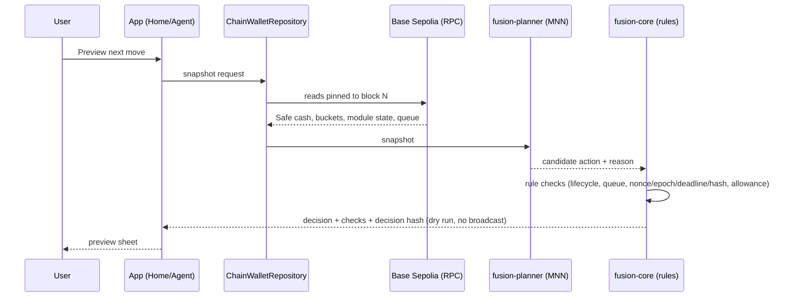
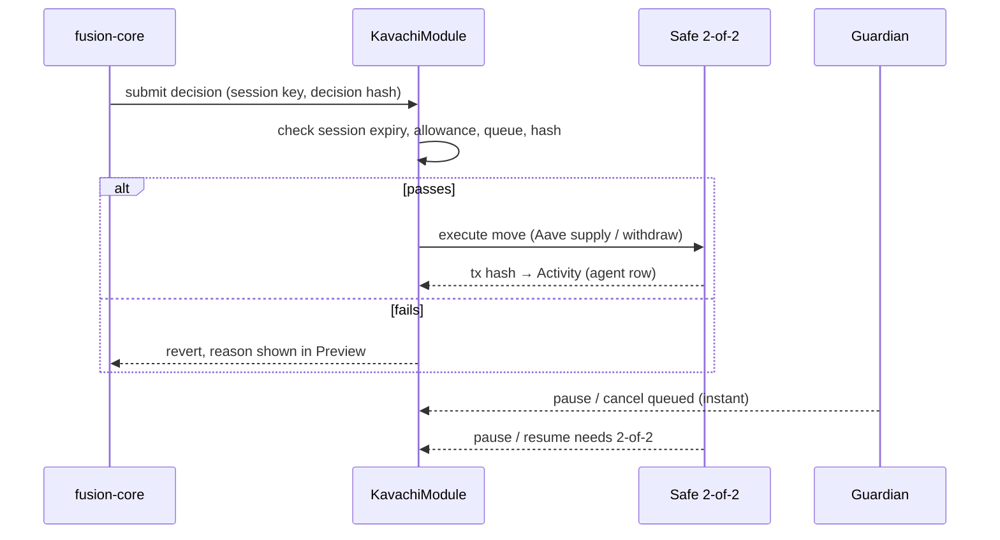
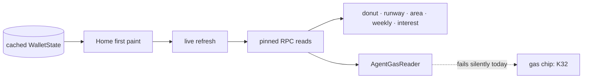
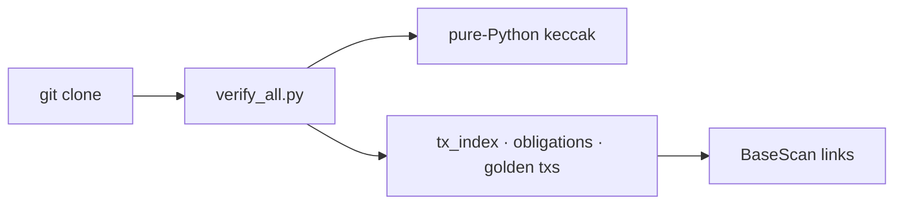

# Fusion Wallet: Features and System Overview

Status as of 2026-10-20. Network: Base Sepolia (test). Scope: FinTechathon 2026, Topic F "Agent Wallet".

## 1. Features

### Wallet and money
- Safe 2-of-2 smart account holds the USDC (Base Sepolia).
- Four buckets: safe cash, bills (commitments), safety buffer, and earning (vaults).
- Spare cash = cash left after bills and buffer. Only spare cash is usable by the agent.
- Receive: QR sheet with the Safe address and a network warning.
- Earn: moves spare cash into a vault (Aave waUSDC, or the demo vault).
- Vault withdraw returns funds to Safe cash. Vault balances show "Available anytime" when liquid.

### AI agent (on-device)
- On-device planner: MNN runtime with the AHEM-G model. No cloud LLM is needed.
- Deterministic planner available as the fallback.
- Each tick produces a decision: a candidate action (move, return, rebalance, pay, or hold) with a reason.
- Preview ("Preview next move"): dry run, no broadcast. Shows the chosen action, every policy check, and the snapshot block.
- Policy checks: lifecycle (module live and authorized), queue availability, nonce/epoch/deadline/decision-hash validity, and allowance limits.
- Daily allowance: 4,000 USDC, up to 10 USDC per move (shown on Home).
- Decision hash binds the decision to the snapshot; it is checked before any execution.

### Guardrails and controls
- Guardian: can pause the module (instant stop) and cancel queued actions.
- Pause and resume need 2-of-2 approval through the Safe.
- Approval banner: appears only when an action is queued. Guardian Cancel is real; Approve goes to the Safe 2-of-2 flow.
- Permission tiers: read-only, autonomous (with limits). Read-only blocks execution.
- Session key: time-limited, scoped to the module. Expiry is checked on every preview.
- Owner keys are never in the app.

### Obligations and accounting
- Bills and obligations come from a verified commitment (by-root index).
- Next obligation card; "Worth knowing" insights.
- Accountant chat ("Ask the Accountant"): answers grounded in on-chain data.
- Accounting checks compare app totals with chain-derived records. Mismatch is shown, not hidden.

### Charts and Home (K21–K30)
- Where it sits donut: spare cash, bills, earning, with amount and %.
- Cash runway gauge: days of cash at current pace. Under 12 h of history: "Not enough history yet". Under 7 days: "Early estimate".
- 30-day total area line with % change.
- Weekly spend pill bars (3w, 2w, 1w, Now) by payee.
- Interest per year: Aave (real rate), Demo (simulated, labelled).
- Refresh button; cached first paint, then live refresh.
- Agent gas footer ("Agent gas: X ETH (~N moves)"): **not yet visible on device; fix in progress (K32).**

### Activity and provenance
- Activity feed grouped by transaction (txHash + title).
- Each agent row shows its planner (for example "On-device MNN · AHEM-G") and provenance.
- Owner actions and agent actions are labelled separately. Placeholder "not recorded" money rows are hidden.
- Explorer links open in the browser through a safe intent helper (no crash without a browser).

### Onboarding
- Stepper: currency, role selection (preselected from saved state), model download.
- Model download respects Wi-Fi preference (fail-open check).
- Self-test on first run; shows a clear error if the native library is missing.

### Safety and settings
- Safety tab: guardian status, pause/resume, allowance, and risk notes.
- Settings: network, planner choice, and diagnostics.

### Evidence and verification (for judges)
- 37 on-chain transactions indexed in `evidence/tx_index.json`.
- Includes 30 SCRIPT rows, 3 AGENT golden txs, a demo run, pause/resume, and an in-app agent tx.
- `scripts/judge/verify_all.py`: 48/48 checks, keyless, python3 only (pure-Python keccak).
- Reproducible builds: `scripts/android_planner/build.sh`; hash-verified prebuilt native libs (`ahem-mnn-android-v1`).
- Public APK: `app-latest` release (last published K28). K30 and K31 pending screen check.

### Security research (arena)
- 24 attack scenarios; 23 stopped. A12 (x402) is the only escape, recorded as a known gap.
- Frozen corpus: attack success 0/30, false block rate 9/30.
- Held-out corpus: attack success 0/20, false block rate 13/20.
- K25 reviewer mode failed its gate and is off by default.

### Explicitly not built (rejected on purpose)
- Send, Swap, vault Add/Withdraw buttons: no owner keys in the app and no verified swap pool. Shown as absent, not as dummy buttons.

## 2. Architecture

Five layers. Each layer only trusts the one below it through a fixed interface.

```
┌──────────────────────────── Android app (Kotlin, Compose) ────────────────────────────┐
│ Home · Bills · AI Agent · Activity · Safety · Onboarding · Settings                   │
│ WalletState ◄── ChainWalletRepository (cache first, live refresh)                    │
└───────────┬───────────────────────────────┬───────────────────────────────────────────┘
            │ JNI / local call              │ JSON-RPC (read-only, snapshot-pinned)
┌───────────▼─────────────┐        ┌────────▼───────────────────────────────────────────┐
│ fusion-core (Rust)      │        │ Base Sepolia                                       │
│ preview.rs: rule checks │        │ Safe 2-of-2 · KavachiModule · Aave USDC adapter    │
│ decision hash           │        │ Guardian · session key · events                    │
│ agent-runner            │        └────────────────────────────────────────────────────┘
└───────────▲─────────────┘
            │ decision candidates
┌───────────┴─────────────┐        ┌────────────────────────────────────────────────────┐
│ fusion-planner          │        │ evidence/ + scripts/                               │
│ MNN + AHEM-G (on-device)│        │ tx_index, obligations by-root, arena results,      │
│ deterministic fallback  │        │ verify_all.py (48/48, keyless)                     │
└─────────────────────────┘        └────────────────────────────────────────────────────┘
```

### Components
| Component | Location | Role |
|---|---|---|
| Android app | `src/Fintech_Wallet_Agent/fusion-core-android` | UI, state, onboarding, activity, charts |
| fusion-core | `src/fusion-core` | policy rules, preview, decision hash |
| fusion-planner | `src/fusion-planner` | on-device planner (MNN, AHEM-G) |
| ahem / mnn-android-sdk | `src/ahem`, `src/mnn-android-sdk` | native inference, prebuilt libs |
| Contracts | `src/contracts` | KavachiModule, HashV41, Safe integration |
| Evidence and scripts | `evidence/`, `scripts/` | tx index, obligations, verification, arena |
| Docs | `docs/ux/`, `JUDGES.md`, `README.md` | UX plan, dashboard layout, judge path |

### Main flows

**A. Agent tick and Preview**


**B. Execution (agent action)**


**C. Home refresh**


**D. Verification (judges)**


## 3. Known gaps (say these openly in the demo)
- Agent gas chip missing on device. Fix in progress (K32, codex_1).
- Pending screen check for K30 and K31 on device before the public APK is updated.
- A12 (x402) attack path escapes the guard.
- Reviewer mode (K25) off by default.
- Send and Swap are not built on purpose.
