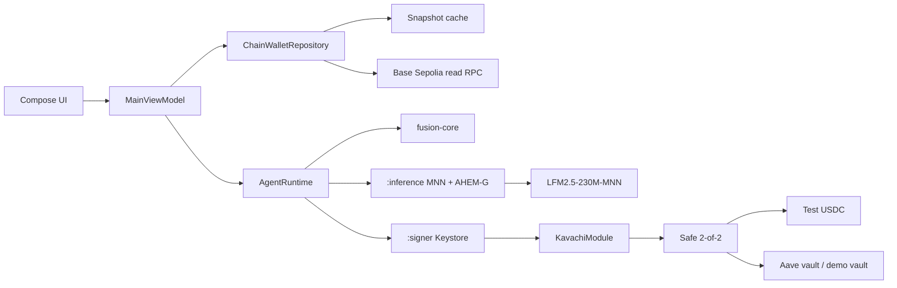
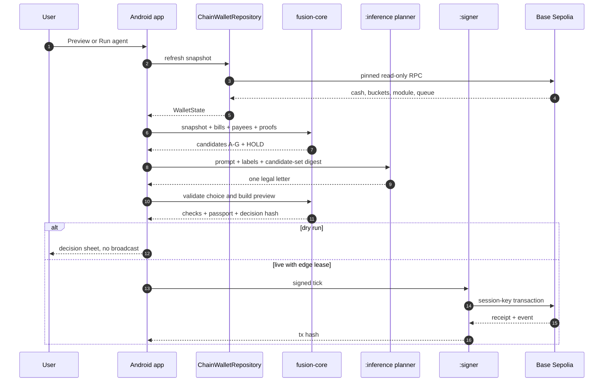
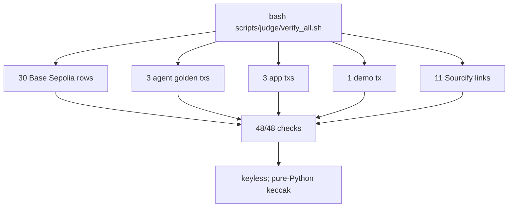

# Fusion Wallet: Features and System Overview

Status: 2026-10-20. Network: Base Sepolia testnet (chain ID `84532`), test USDC only. Scope: FinTechathon 2026, Topic F “Agent Wallet”.

Fusion Wallet is a small-business treasury where an on-device model can pay verified bills, keep reserves intact, and sweep only surplus cash into yield vaults. The model chooses from a closed set of prepared actions; it never writes an address, calldata, or amount. Policy is enforced independently by `fusion-core` and by the on-chain `KavachiModule`.

## 1. What the demo proves

1. **Bounded decisions.** The model receives candidates `A–G` plus `H` (HOLD) and can only choose a letter. AHEM-G forces the legal output envelope inside the native sampler.
2. **Independent policy.** The Android app previews a decision through `fusion-core`; the contract re-checks authority, limits, reserve accounting, queue state, nonce, epoch, and the obligation proof before moving funds.
3. **Auditable execution.** Every executed action carries a `decisionHash` equal to `keccak256` of the canonical JSON passport. Evidence rows and passport hashes are published for judges.

## 2. Features

### Treasury and money
- A Safe `2-of-2` smart account holds the test USDC. The `KavachiModule` is enabled on the Safe and executes only within its policy.
- Three displayed buckets:
  - **Spare cash:** cash left after the committed bills reserve and the operating buffer.
  - **For bills:** the funded reserve plus the operating buffer.
  - **Earning:** assets held in the Aave waUSDC vault or the demo vault.
- Cash accounting uses `C - assets >= R + B`: a deposit may use only surplus above committed bills `R` and buffer `B`. Bill payments are limited to the committed reserve and require a valid Merkle proof.
- **Receive:** offline-generated QR of the Safe address, copy confirmation, BaseScan link, and the warning “Send USDC on Base Sepolia (test network) only”.
- **Earn is a preview, not a deposit.** It calls `runAgentTick(dryRun = true)` and opens a plain-language decision sheet with the proposed action, vault/vendor, snapshot block, policy checks, and any queue or owner-approval requirement. No transaction is broadcast.
- **Vault withdraw is an agent/authority action,** not a Home button. The candidate set includes a `WITHDRAW` when cash falls below reserve plus buffer. The Home vault tiles expose no Add/Withdraw buttons; they show assets, `maxWithdraw`, shares, exposure cap, and the vault address. The policy trusts exactly two vaults: Aave waUSDC and the demo vault.
- After every deposit, the module resets the Safe-to-vault allowance and checks that it is exactly zero. A residual allowance would fail the action.
- Owner actions that create or change obligations require the Safe’s `2-of-2` flow. The app links to the Safe rather than pretending an owner action happened.

### Policy and controls
The deployed policy is `AUTONOMOUS`, with these configured values (`src/contracts/script/Setup.s.sol`, `deployments/84532.json`):

| Control | Configured value | Behaviour |
|---|---:|---|
| Daily gross limit | 4,000 USDC | UTC-day cumulative agent spend; a new session does not reset it |
| Session gross limit | 8,000 USDC | Per-session cumulative spend; setup session lasts 23 hours |
| Instant tier | ≤ 10 USDC | Executes immediately when the preview passes |
| Delayed tier | > 10 and ≤ 100 USDC | Must be queued; 180-second timelock |
| Owner-approved tier | > 100 and ≤ 2,500 USDC | Requires Safe approval; queued actions also require the delay |
| Hard maximum | 2,500 USDC | Anything larger reverts |
| Operating buffer | 500 USDC | Part of the cash that deposits must leave untouched |
| Vault exposure cap | 6,000 USDC per vault | Checked before deposit |
| Share slippage | 50 bps | Bound on deposit/withdraw share movement |
| Payee cooling | 3,600 seconds demo setting | Production default is 24 hours |
| Pay-early window | 3 days | Agent may pay a committed bill up to 3 days before `dueAt` |
| Queue delay bounds | 120–900 seconds | Contract rejects a configured delay outside this range |

- Permission tiers are `READ_ONLY`, `OWNER_APPROVED`, and `AUTONOMOUS`. The deployed tier is `AUTONOMOUS`; read-only blocks every agent action.
- The queue is one action at a time. A queued action must match the current session and digest, become ready after the delay, and execute before its deadline. Cancel/expiry consumes the nonce.
- The Safe is the only approver. The guardian is a separate `stopper`: it can pause immediately, cancel a queued action, cancel a payee, or call `emergencyUnwind`, but it cannot approve an action or resume the module. Resume is Safe-only and requires the `2-of-2` owners. Each pause changes the policy epoch and invalidates a live queue.
- The queue banner appears only when the live module queue has an item. “Approve in Safe (2 of 2)” opens an explanatory sheet with the action digest and Safe link; it does not submit an approval itself.
- The app defaults to **Dry run**. A live tick can be requested with a confirmation, but `AgentRuntime` requires the edge session lease and the isolated `:signer` Keystore session key; without them it fails closed. Home Earn and Preview always run dry.
- The app imports guardian and session keys only. Owner keys are never in the app.
- The current queue banner is honest about a build limitation: the contract supports guardian queue cancellation, but the monitor build has no public digest-bound cancellation API. It shows cancellation as unavailable rather than faking a button. Pause is never presented as queue cancellation.

### AI agent, on-device
- Planner pipeline: `MainViewModel.runAgentTick(dryRun)` → `AgentRuntime` → fresh pinned snapshot → `fusion-core` candidates → MNN/AHEM-G in `:inference` → canonical passport → `fusion-core` preview.
- Model: `LFM2.5-230M-MNN`, run locally by the pinned MNN fork. No cloud LLM is needed for financial decisions, and the Android runtime has no server planner or deterministic fallback; it fails closed instead.
- AHEM-G forces the JSON skeleton and restricts sampling to the current legal candidate labels. Invalid or aborted output maps to HOLD.
- The session key is scoped to the module and time-limited (23 hours in setup). The contract rejects an expired session; the preview exposes the expiry.
- Candidates are `PAY_OBLIGATION`, `DEPOSIT`, `WITHDRAW`, and `HOLD`, each with a reason code and before/after bucket preview. `REBALANCE` is unsupported by the contract.
- A **Preview** is a dry run: it shows the chosen action, every policy check, the snapshot block, and the decision hash. It does not broadcast.
- A **live tick** is signed by the session key in `:signer` and executed through `KavachiModule`. The module re-runs authority, lifecycle, nonce/epoch, deadline, limit, reserve, vault, and proof checks.
- The decision passport binds the chain, Safe, module, snapshot block/hash, mandate hash, candidate-set digest, chosen label, route, model hashes, and AHEM statistics.
- The signer/verifier rejects stale candidate-set digests and re-runs an independent core preview before signing. It also verifies RPC code pins, EIP-1967 implementation pins, live authority, `eth_call` simulation, fee/gas bounds, receipt, transaction bytes, and the `ActionExecuted` event.

### Accountant
- The **Local Accountant** runs on-device as pure Kotlin and is the source of exact figures. It compares app totals with chain-derived records and surfaces mismatches.
- The cloud accountant is opt-in and **OFF by default**. When enabled, it receives only a capped, sanitized, coarse brief, not the private ledger or raw balances.
- The cloud model is read-only: it returns advisory text and has no signing, transfer, or policy authority. DeepInfra models are allow-listed; Google/Anthropic models are refused by the privacy policy.

### Obligations and vendors
- Bills are committed as a Merkle root with `reservedRaw` and a count. A payment needs a valid proof and cannot be paid twice.
- The fifth bill remains unpaid/reserved in the handoff state; the first four published bill IDs are permanently paid.
- Payees are registered by the Safe and have an `activeAt` cooling time. The demo sanctions oracle is a **TEST LIST**; a listed payee cannot be paid.
- The contract emits the full lifecycle: `PolicyConfigured`, `ObligationsCommitted`, `PayeeAdded`, `PayeeCancelled`, `SessionStarted`, `SessionRevoked`, `ActionApproved`, `ActionApprovalRevoked`, `ActionQueued`, `QueueCancelled`, `QueueExpiredEvent`, `QueueInvalidated`, `ActionExecuted`, `ObligationPaid`, `Paused`, `Resumed`, `EmergencyUnwind`, and `UnwindLegFailed`.
- “Add vendor / commit bills” explains that both Safe owners must act and links to the Safe. There is no dead form.

### Home, charts, and activity
- **Where it sits** donut: Spare cash, For bills, Earning.
- **Cash runway** gauge: starts at 12 hours of history; below 12 hours it says “Not enough history yet”, and below 7 days it says “Early estimate”.
- **Total, last 30 days** area line from Safe USDC transfers and module checkpoints.
- **Weekly spend** bars by vendor; **Interest per year** from the live Aave supply rate and a labelled simulated demo-vault rate.
- **Agent gas** chip: session-key ETH balance, plus `(~N moves)` only when a median gas cost from indexed receipts is available. Unknown history omits `N`; an unavailable balance omits the chip. The chip is rendered by `HomeCharts.kt`.
- Cached snapshot paints first, then live refresh. A failed refresh does not erase the last known state.
- Activity is grouped by transaction and tagged `APP`, `AGENT`, `OWNER`, or `SCRIPT`. Agent rows include the planner provenance. Unknown source is shown as unknown, never guessed.
- Explorer links open through a safe intent helper; no browser does not crash the app.

### Onboarding, settings, safety
- Six onboarding steps, each with Back/Skip/Next:
  1. Welcome and role: Owner, Finance approver, or Auditor.
  2. Network and currency: Base Sepolia TESTNET and the deployment’s USDC.
  3. Connect treasury: Safe code, `2-of-2` threshold, module enabled, and Sourcify verification at one block.
  4. On-device model: ~131 MB resumable download, SHA-256 verification, then a warm-up self-test decision.
  5. Keys: authority table and import into Android Keystore, or continue view-only.
  6. Policy review: read-only tier, daily/session limits, reserve buffer, and verified vendors.
- Settings: network/deployment contracts with copy and explorer/Sourcify links; model hash, size, last latency, re-download, and re-verify; guardian/session import status and removal; English/中文; Judge mode commands; app version, build type, model ID, and network; re-run onboarding.
- Safety is `ProofScreen`: headline count, stopped/succeeded scorecard, pause state, blocked on-chain attempts, stopped arena scenarios, and known limits. The score comes from evidence, not hardcoded UI text. Emergency unwind is explanatory and presented as an owner `2-of-2` Safe action; the app cannot trigger it because it does not hold owner keys.

## 3. Architecture



### Components

| Component | Location | Role |
|---|---|---|
| Android app | `src/Fintech_Wallet_Agent/fusion-core-android` | Compose UI, wallet state, onboarding, charts, activity, safety |
| `fusion-core` | `src/fusion-core` | Candidate enumeration, preview checks, passport/hash construction |
| `fusion-planner` | `src/fusion-planner` | MNN/AHEM-G planner; Android JNI wrapper |
| MNN/AHEM | `src/mnn-android-sdk`, `src/ahem` | Pinned inference runtime and grammar gate |
| Contracts | `src/contracts` | `KavachiModule`, `KavachiPolicyLib`, `HashV41`, registry, demo vault |
| Evidence/scripts | `evidence/`, `scripts/` | Receipts, passports, arena results, keyless verifiers |
| Docs | `docs/`, `JUDGES.md`, `README.md` | UX plan, evidence, judge path |

### Agent tick



The Home Earn and Preview paths are dry runs. A live tick requires the edge session lease; the UI is not the only authority boundary.

### Verification for judges



`verify_all` checks the evidence sets above, with no private keys. It requires network access to Base Sepolia and Sourcify; without it, the checks cannot complete.

## 4. Deployed contracts (Base Sepolia)

From `deployments/84532.json`. Addresses are copied exactly as stored in the manifest.

| Contract | Address | Notes |
|---|---|---|
| Safe proxy | `0x029869910714D9e09b854a2688311AFd42fBb44E` | Treasury; threshold 2 of 2 |
| `KavachiModule` | `0xA560ec10259657E9bADd297E68286d2838Cd5a8f` | Guard module; linked to the policy library |
| `KavachiPolicyLib` | `0x7ee721922dffe2bee9ec8e4ef51646110e6cbc1f` | Deployed library |
| `PayeeRegistry` | `0xD798F4DF0dEf13971870AEfEE7fce4691F739B5b` | Active/cooling payees and sanctions check |
| Test USDC asset | `0xba50Cd2A20f6DA35D788639E581bca8d0B5d4D5f` | Aave test USDC (external) |
| Aave waUSDC vault (`vaultA`) | `0xf430cb6E2b85f99222fBFA6dFEa18Ff60FA6B32a` | External ERC-4626 vault |
| Demo vault (`vaultB`) | `0xf052C0ED8404adEaAEA773A5F8Ae4628134aff6D` | `KavachiDemoVault`; simulated yield |
| Test sanctions list | `0xd2716e08BCe6eb5B1f01329FF5E1a2dd0468B678` | TEST LIST, not a production oracle |
| Safe singleton | `0x29fcB43b46531BcA003ddC8FCB67FFE91900C762` | Canonical Safe v1.4.1 |
| Safe proxy factory | `0x4e1DCf7AD4e460CfD30791CCC4F9c8a4f820ec67` | Canonical Safe |
| Safe fallback handler | `0xfd0732Dc9E303f09fCEf3a7388Ad10A83459Ec99` | Canonical Safe |
| MultiSendCallOnly | `0x9641d764fc13c8B624c04430C7356C1C7C8102e2` | Used for the setup batch |

Roles: owner `0x61dd06cE2f07d3E4F97d097741b0D7FD50F97F79`; approver `0x208Bfee9F222d611b4Db71d5ee53b3dAB1A2188A`; guardian `0x46B8E40EB9767BD46E03C5eCF398C10E1372251E`; session `0xB52Cb48eC1cc5Ad1171C83F162228e31752F87fA`; ops `0xC78Be9Da2204CC3020B055520102479FA3175066`; deployer `0x77A9224AAc84d496a4ad0E865dcA9eA27B6a22Da`.

### Handoff snapshot

At block `48,319,954` (2026-10-19 11:09:56 UTC), the manifest records: module paused; session cleared; no queued action; cash `9,467.001235` test USDC; reserved `50` USDC; daily gross used `2,093 / 4,000` USDC (remaining `1,907`); both vault balances and Safe-to-vault allowances zero after emergency unwind. This is a handoff snapshot, not a claim about the current live block.

## 5. Evidence and verification

| Evidence set | Count |
|---|---:|
| `evidence/base-sepolia.json` | 30 rows / 26 unique transactions, source `SCRIPT` |
| `evidence/agent/golden.json` | 3 broadcast agent txs + 1 HOLD |
| `evidence/app/guardian_pause.json` | 2 app txs: guardian pause + owner resume |
| `evidence/app/agent/golden_app.json` | 1 in-app agent tx |
| `evidence/demo/runs.json` | 1 demo tx |
| `evidence/tx_index.json` | 37 rows / 37 unique hashes |
| Sourcify links in the deployment manifest | 11 |
| `verify_all` total | **48 checks** |

The app’s Activity feed uses the 37-row index. Sources are `SCRIPT` 26, `OWNER` 5, `AGENT` 4, and `APP` 2. The base evidence set is the 30-row SCRIPT receipt set; the other rows are agent, app, and demo evidence.

Reproduction:

```bash
bash scripts/judge/verify_all.sh
python3 scripts/verify_evidence.py evidence/base-sepolia.json
python3 scripts/agent/check_golden.py
```

### Build and release
- Android native planner: `bash scripts/android_planner/build.sh`.
- Rust core: `bash scripts/android_planner/build_core.sh`.
- Check: `bash scripts/android_planner/check.sh`.
- `scripts/android_planner/fetch_prebuilt.sh` downloads the hash-verified `ahem-mnn-android-v1` prebuilt. The Android fork is patched/relinked for the tensor-dimension fix, so it is not claimed byte-identical to the supplied build.
- The APK does **not** include the model. Onboarding downloads and SHA-256 verifies the five model files (~131 MB).
- Public APK: `https://github.com/AdribMahmud101/fusion_wallet/releases/download/app-latest/fusion-wallet.apk` with an adjacent `.sha256`. The release asset is separate from this source checkout; verify its checksum and do not infer a build identity from the `app-latest` tag.

## 6. Security research and known limits

- Attack arena: 24 scenarios, **23 stopped, 1 escaped, 0 not implemented** (`evidence/results/ARENA.md`). A12 is the escape: x402 overcharge/arbitrary prepared transaction, because a dedicated x402 signer/payment path is not built.
- Frozen corpus: ASR `0/30`, FBR `9/30` (`9/28` actionable). Held-out: ASR `0/20`, FBR `13/20` (`13/18` actionable). ASR measures off-chain proposal admission, not realized on-chain loss.
- The arena run recorded 155 passing contract/Rust suite checks. Contract `STATUS.md` separately reports 157 Foundry tests passing.
- K25 reviewer mode proposed a model veto over policy proposals. It failed its safety gate (`1/30` corpus ASR and `1/20` held-out ASR), so the default remains the `ahem-g` chooser and reviewer mode is off.
- Known gaps, stated openly:
  - A12 x402 signer/payment path is not built.
  - Automatic depeg reflex/latch is not implemented; A10 uses a paused snapshot/guardian pause.
  - The core accepts stale digest JSON in one probe; no production digest-binding adapter is claimed. The contract rejects an explicitly stale policy epoch.
  - AHEM-L, real invoice PDF parsing, and UI lookalike detection are not evaluated.
  - Send, Swap, and vault Add/Withdraw buttons are intentionally absent. There are no owner keys in the app and no verified swap pool.
  - The guardian queue-cancel contract path exists, but the current app build does not expose the digest-bound API.
  - The safest statement about the public APK is the release page plus its checksum, not a specific K-number.
