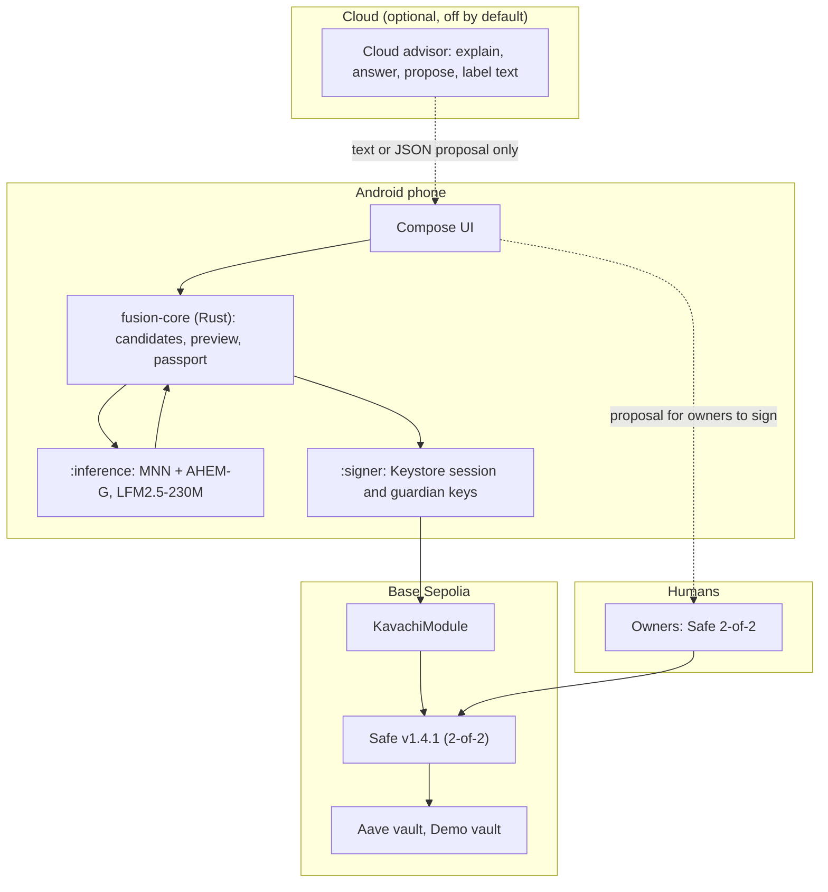
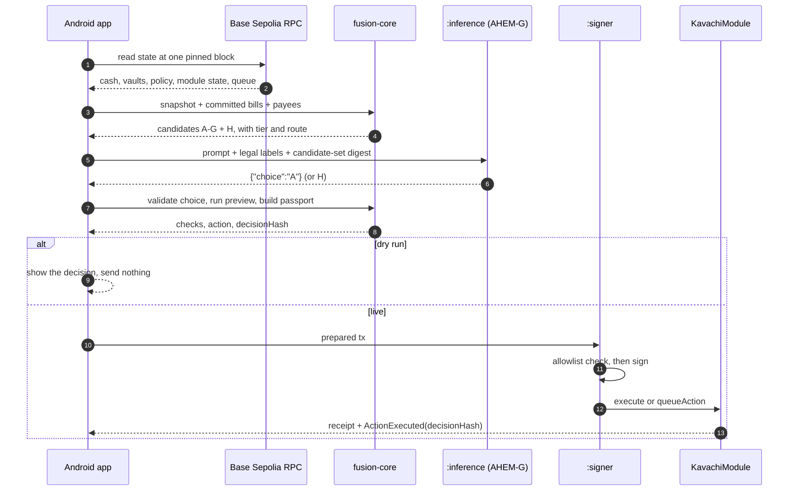

# Fusion Wallet: Technical Document

FinTechathon 2026 · International Track · Topic F "Agent Wallet".
Network: Base Sepolia testnet (chain 84532). Test money only. Status date: 2026-10-20.

Source paths sit next to the claims. Open items are marked `[PENDING: card]`.

## 1. What it is

Fusion Wallet is a stablecoin treasury for a small business. An AI model runs on the phone. It pays verified bills,
keeps reserves safe, and moves only spare cash into yield vaults. It does this without a human tap.
It cannot be talked into losing money, because it never holds that power.

> On-device AI acts. Cloud AI explains and proposes. On-chain rules decide. Humans hold the keys.

Topic F asks for an agent that "autonomously executes on-chain operations (asset management, transaction execution,
risk control)". Where we stand on each (`docs/WIN_PLAN.md` for the plan, `evidence/tx_index.json` for what exists):

| Topic F operation | What exists today | Still open |
|---|---|---|
| Transaction execution | 5 txs sent by the on-device AI's key (4 AGENT, 1 APP): 4 bill payments and 1 queue step (`docs/deliverables/TX_HASHES.md`) | none for the core path |
| Asset management | K38's 10 USDC deposit and withdrawal by the AI session key under an owner 2-of-2 rehearsal mandate; explicitly not an autonomous investment | A profitable, self-initiated deposit remains pending: live 50 USDC quote is not actionable (17.44 days) |
| Risk control | In-app guardian pause (APP) and a 2-of-2 resume (OWNER). 24 of 24 attacks stopped | Automatic pause on an anomaly `[PENDING: K41]` |

## 2. Architecture

### 2.1 Layers



Four checks stand between the model and the money:

1. **Candidate confinement.** The model picks a letter, nothing else.
2. **Core preview.** Rust re-runs the contract rules before signing.
3. **Signer allowlist.** Only module calls are signed.
4. **The contract.** It re-checks everything and is the final authority.

### 2.2 Components

| Component | Path | Role |
|---|---|---|
| Android app | `src/Fintech_Wallet_Agent/fusion-core-android` (git submodule, branch `fusion-v3-integration`) | Compose UI, live chain monitor, Autopilot, three processes (`:main`, `:inference`, `:signer`) |
| `fusion-core` | `src/fusion-core` | Pure Rust: snapshot, candidate enumeration, economics, preview, passport and hashing, signer policy |
| `fusion-planner` | `src/fusion-planner` | MNN runtime plus AHEM-G grammar gate. Android JNI wrapper |
| MNN, AHEM | `src/mnn-android-sdk`, `src/ahem` (submodules) | Pinned inference runtime and gate dependency |
| Contracts | `src/contracts` | `KavachiModule`, `KavachiPolicyLib`, `KavachiPayeeRegistry`, `HashV41`, demo vault |
| Evidence and verifiers | `evidence/`, `scripts/` | Receipts, passports, arena results, keyless checkers |
| Arena | `arena/` | Frozen attack and benign corpora, generator |

### 2.3 Data flow of one decision



## 3. Core algorithm

### 3.1 Snapshot (`src/fusion-core/src/snapshot.rs`)

All chain state is read at a single block number and hash through Multicall3. A failed read is an error.
It never becomes a zero or a placeholder. In the app, a snapshot is stale after 30 seconds or 5 blocks.

### 3.2 Candidates (`src/fusion-core/src/candidates.rs`)

The core builds at most 7 candidates, labelled `A`–`G`, plus `H` (HOLD). The order is fixed:

1. **Pay a due bill.** The bill is committed, unpaid, inside the pay-early window, the payee is active and not
   cancelled, and cash covers it. Sorted by due date, then obligation hash.
2. **Safety withdraw.** If cash `C` is below reserved bills `R` plus operating buffer `B`, withdraw the shortfall
   from the vault with the lowest rate, capped by vault assets and measured pool liquidity.
3. **Invest surplus.** If the sweepable amount is above zero, offer a deposit for each pinned vault,
   limited by vault headroom, the per-move cap and the hard max. A deposit is offered **only if its measured
   economics are `ACTIONABLE`** (section 4). Under the `AUTONOMOUS` tier the per-move cap is the instant limit.
4. **HOLD.** Always present.

Each candidate has a tier and route:

| Amount | Tier | Route (tier `AUTONOMOUS`) |
|---|---|---|
| ≤ instant limit | Instant | Execute now |
| ≤ delayed limit | Delayed | Queue, wait for the delay, execute |
| ≤ hard max | Owner | Needs a Safe approval |
| above hard max | Reject | Not offered |

The model never sees an address, calldata or an amount that it can edit. It sees redacted facts and letters
(`src/fusion-core/src/planner_io.rs`, `build_planner_prompt`).

### 3.3 On-device planner (`src/fusion-planner`)

- Model: LFM2.5-230M-MNN, Apache-2.0 per its model card. File hashes are recorded in `evidence/planner/host_results.json`.
  The app downloads the model on first run and checks the SHA-256 of all five files (about 131 MB).
- **AHEM-G** is a grammar gate inside the MNN sampler callback. It forces the skeleton `{"choice":"` and `"}`,
  bans illegal tokens before they are emitted, and retries. If retries run out it returns `H` with `aborted=true`.
- It proves the output is a legal letter or a HOLD. It does **not** prove the letter is a good choice.
- Host results on a 200-prompt adversarial set (`evidence/planner/host_results.json`):

| Mode | Prompts | Illegal outputs | Invalid final outputs | Aborts | Vetoes |
|---|---|---|---|---|---|
| AHEM-G | 200 | 0 | 0 | 0 | 46 |
| Plain (gate off) | 200 | 0 | 48 | 48 | 0 |

- Latency on the host: median 116.6 ms with AHEM-G, 140.0 ms plain. On the phone: cold load about 0.85–0.99 s and
  decode 0.4–0.5 s on a OnePlus 11 (`evidence/app/agent/README.md`, M1/M2). Sampler-only overhead is `NOT_MEASURED`.

### 3.4 Validation and preview (`planner_io.rs`, `preview.rs`)

`validate_planner_output` accepts one legal label. Anything else becomes `H`.
`preview_candidate` then runs the same rules the contract runs, with no network, no key and no nonce use:
lifecycle, queue gate, nonce/epoch/deadline/decision hash, shape and hard max, daily and session velocity, then the kind-specific
reserve, vault, slippage and payment rules. It returns every check with a pass or fail.

### 3.5 Decision hash and passport (`passport.rs`, `hashing.rs`)

The passport is canonical JSON (RFC 8785). It binds the chain, Safe, module, snapshot block and hash, mandate hash,
candidate set, chosen label, route, model and library hashes, and AHEM statistics.
`decisionHash = keccak256(canonical passport)`. The hash goes into the transaction and into the `ActionExecuted` event,
so anyone can recompute it from the published passport (`scripts/agent/check_golden.py`).

### 3.6 Signer (`src/fusion-core/src/sign.rs`, Android `SessionSigningPolicy.kt`)

The session signer signs a transaction only if all of these hold:

- `to` equals the module address from the bundled deployment manifest (not from the transaction);
- value is 0;
- chain id matches;
- the selector is `execute` (`0x4cc7ca06`) or `queueAction` (`0xf63baabc`);
- the call data decodes and re-encodes to exactly the same bytes.

Anything else returns `SignerRefused`. The selectors are derived from `IKavachiModule.sol`, not typed by hand
(`evidence/K35-session-signing.md`). The guardian path signs a zero-value module `pause` only.

### 3.7 The contract (`src/contracts/src/KavachiModule.sol`)

A Safe v1.4.1 module that only uses `Operation.Call` with value 0. It re-checks lifecycle, nonce, epoch, deadline,
limits, reserve (`C - assets ≥ R + B`), vault allowlist and code hash, share bounds, Merkle proof for bills, payee status
and sanctions. After a deposit it resets the allowance and requires zero. Full list in `SECURITY_SELF_ASSESSMENT.md` section 2.

## 4. Quant guards (K44, `src/fusion-core/src/quant.rs`)

A yield move is offered only when its economics are measured and pay back fast enough.
All math is integer. Gas in USD micro-units. APY in parts per billion. Missing data gives `UNMEASURED` and no candidate.

| Guard | Rule |
|---|---|
| **Utilization** | Aave utilization = debt / (available + debt). A deposit is blocked above **85%** |
| **Conservative APY** | `min(spot APY, realized APY over about 24 h)`. Spot from the reserve's liquidity rate. Realized from the liquidity-index growth. Rounding always lowers the rate. If history is missing the label says "spot only". Bad history blocks the move |
| **Gas in USD** | Median actual fee of the session key's indexed receipts (up to 20, last 30 days, including L1 fees) × Chainlink ETH/USD |
| **Oracle** | Pinned Base Sepolia ETH/USD feed `0x4adc…7cb1`, 8 decimals. Stale after 1,200 s, from the future, zero or incomplete rounds give `UNMEASURED` |
| **Slippage** | Measured `previewDeposit` → `convertToAssets` round-trip loss at the exact size. The 50 bps policy bound is a limit, not a cost |
| **Break-even** | `days = (gas + slippage) × 365 / (size × (new APY − current APY))` |
| **Gate** | `ACTIONABLE` only if break-even ≤ **14 days**. Otherwise `UNPROFITABLE_AFTER_GAS`. The rejected measurement is kept so a HOLD can explain itself |

Measured example (read-only capture at Base Sepolia block 48,358,262, `evidence/app/agent/K44_economics.md`):

| Item | Value |
|---|---|
| Aave utilization | 20.69% |
| Conservative APY | 0.2055852% |
| Gas cost per move | 0.003207 USD (rounded up) |
| 10 USDC deposit | `UNPROFITABLE_AFTER_GAS`, break-even 56.96 days. Not offered |
| 41 USDC deposit | `ACTIONABLE`, break-even 13.90 days |
| Threshold at these costs | 40.682473 USDC |

This is a measured proposal for the owners, not an authorization. The per-move cap stays at the owners' setting.
A threshold holds only for the costs captured with it. Yield is tiny on a testnet pool, so the guard mostly says HOLD.
That is the correct answer there. The fresh 50 USDC quote remains UNPROFITABLE_AFTER_GAS; no policy change was made.

Tests recorded with K44 (`evidence/app/agent/K44_validation.md`): `cargo test` in `src/fusion-core` 190 passed;
Android `testDebugUnitTest` 261 passed with 4 live or device tests skipped. Later cards were not re-run here.

## 5. Autopilot and the event router

### Autopilot (K39, merged)

Code: `src/Fintech_Wallet_Agent/fusion-core-android/app/src/main/java/app/fusion/wallet/agent/autopilot/`.

- A toggle on the AI Agent screen. Interval 1, 5 or 15 minutes (default 5). **Run now** and **Stop**.
- Runs while the app is in the foreground. It needs no background service. Leaving the foreground cancels it.
- Each tick checks nine guards (network, app access, guardian stop, fresh live snapshot, module configured,
  module not paused, tier not read-only, active session, bill accounting matches the on-chain commitment).
  Any failure records a HOLD with the reason.
- Then it runs the normal decision path: candidates, planner, validate, preview. A live tick signs only if the
  device has the session lease and key. Otherwise the tick is a preview.
- The timeline keeps the last 50 ticks in app-private storage. A BaseScan link appears only for a verified execution hash.
  "Executed" means the receipt was verified.
- Stop cancels the current tick and turns Autopilot off. A transaction already sent may still confirm.

### Event router and reflex

- Heartbeat (the Autopilot interval) exists.
- Cognitive trigger, gas-spike defer, wake-reason labels on the timeline: `[PENDING: K45]`
- Reflex interrupt that pauses with no model in the loop: `[PENDING: K41]`

## 6. Security design

Short form. The full table is in `SECURITY_SELF_ASSESSMENT.md`.

- **Bounded by construction.** The model cannot output an address, amount or calldata.
- **Independent checks.** Rust preview and the contract use the same rules. The contract wins.
- **Least authority.** Session key: `execute` and `queueAction` only. Guardian: stop only. Owners: everything else, together.
- **Fail closed.** Missing or stale input is a HOLD with a reason.
- **Honest provenance.** Every transaction is indexed as `AGENT`, `APP`, `OWNER` or `SCRIPT`.
  Unknown source shows as unknown (`evidence/tx_index.json`).
- **Cloud model is advisory** (K40, `src/Fintech_Wallet_Agent/fusion-core-android/app/src/main/java/app/fusion/wallet/advisor/`). It returns text or strict JSON that the
  phone validates. A policy proposal becomes a Safe transaction that only the 2-of-2 owners can send.
  Off by default. No key is compiled into the APK.
- **Arena.** 24 of 24 scenarios stopped. Frozen-corpus ASR 0/30 and held-out ASR 0/20 (`evidence/results/ARENA.md`).
  FBR is 6/30 and 10/20 on the same runs (`evidence/app/agent/K44_validation.md`). `[PENDING: K36]`

## 7. Reproduce and verify

### 7.1 Keyless verification (no keys, Python 3 only)

```bash
git clone --recurse-submodules https://github.com/AdribMahmud101/fusion_wallet.git
cd fusion_wallet
bash scripts/judge/verify_all.sh
```

`verify_all` runs 48 checks (`JUDGES.md`, `scripts/judge/verify_all.py`): 30 operator receipts
(`evidence/base-sepolia.json`), 3 agent transactions (`evidence/agent/golden.json`), 3 app transactions,
1 demo transaction (`evidence/demo/runs.json`) and 11 Sourcify links. It uses pure-Python Keccak, so no tools beyond
Python are needed. It needs network access to the Base Sepolia RPC and to Sourcify.
Last recorded result: 48 of 48 pass (`evidence/app/agent/K44_validation.md`).

### 7.2 Contracts

```bash
cd src/contracts
forge build --sizes
forge test           # 157 tests; invariants I1–I7 (src/contracts/STATUS.md)
```

`KavachiModule` runtime is 24,301 bytes, 275 bytes under the EIP-170 limit. Solidity 0.8.24, Cancun, via-IR, 200 runs.

### 7.3 Core and arena

```bash
cd src/fusion-core && cargo test --locked
bash arena/run_arena.sh      # needs the model files, Foundry and Anvil
```

The arena regenerates `evidence/results/latest.json` and `ARENA.md` from fresh runs. Corpus files are hash-checked first.

### 7.4 Android app

```bash
git submodule update --init src/Fintech_Wallet_Agent
bash scripts/android_planner/fetch_prebuilt.sh     # hash-verified MNN libraries
bash scripts/android_planner/build.sh
bash scripts/android_planner/build_core.sh
cd src/Fintech_Wallet_Agent/fusion-core-android && ./gradlew testDebugUnitTest assembleDebug
```

The native step needs the Android NDK and the team's edge build environment (`docs/EDGE_ANDROID_BUILD.md`).
The APK does not contain the model. The app downloads it and checks the hashes.
The public APK is the release asset `app-latest` (`JUDGES.md`). Check its SHA-256 file.

## 8. Deployed contracts (Base Sepolia)

From `deployments/84532.json`. Deployment block 48,317,685. Compiler 0.8.24, Cancun, via-IR, 200 runs.
All 11 deployment links are Sourcify-checked by `verify_all`.

| Contract | Address | Link |
|---|---|---|
| Safe proxy (treasury, threshold 2 of 2) | `0x029869910714D9e09b854a2688311AFd42fBb44E` | [BaseScan](https://sepolia.basescan.org/address/0x029869910714D9e09b854a2688311AFd42fBb44E) |
| KavachiModule (guard layer) | `0xA560ec10259657E9bADd297E68286d2838Cd5a8f` | [BaseScan](https://sepolia.basescan.org/address/0xA560ec10259657E9bADd297E68286d2838Cd5a8f) |
| KavachiPolicyLib (library) | `0x7ee721922dffe2bee9ec8e4ef51646110e6cbc1f` | [BaseScan](https://sepolia.basescan.org/address/0x7ee721922dffe2bee9ec8e4ef51646110e6cbc1f) |
| KavachiPayeeRegistry | `0xD798F4DF0dEf13971870AEfEE7fce4691F739B5b` | [BaseScan](https://sepolia.basescan.org/address/0xD798F4DF0dEf13971870AEfEE7fce4691F739B5b) |
| Test USDC (Aave test asset) | `0xba50Cd2A20f6DA35D788639E581bca8d0B5d4D5f` | [BaseScan](https://sepolia.basescan.org/address/0xba50Cd2A20f6DA35D788639E581bca8d0B5d4D5f) |
| Aave waUSDC vault (vaultA, external ERC-4626) | `0xf430cb6E2b85f99222fBFA6dFEa18Ff60FA6B32a` | [BaseScan](https://sepolia.basescan.org/address/0xf430cb6E2b85f99222fBFA6dFEa18Ff60FA6B32a) |
| Demo vault (vaultB, simulated yield) | `0xf052C0ED8404adEaAEA773A5F8Ae4628134aff6D` | [BaseScan](https://sepolia.basescan.org/address/0xf052C0ED8404adEaAEA773A5F8Ae4628134aff6D) |
| Test sanctions list (TEST LIST) | `0xd2716e08BCe6eb5B1f01329FF5E1a2dd0468B678` | [BaseScan](https://sepolia.basescan.org/address/0xd2716e08BCe6eb5B1f01329FF5E1a2dd0468B678) |
| Safe singleton v1.4.1 | `0x29fcB43b46531BcA003ddC8FCB67FFE91900C762` | [BaseScan](https://sepolia.basescan.org/address/0x29fcB43b46531BcA003ddC8FCB67FFE91900C762) |
| Safe proxy factory | `0x4e1DCf7AD4e460CfD30791CCC4F9c8a4f820ec67` | [BaseScan](https://sepolia.basescan.org/address/0x4e1DCf7AD4e460CfD30791CCC4F9c8a4f820ec67) |
| Safe fallback handler | `0xfd0732Dc9E303f09fCEf3a7388Ad10A83459Ec99` | [BaseScan](https://sepolia.basescan.org/address/0xfd0732Dc9E303f09fCEf3a7388Ad10A83459Ec99) |
| MultiSendCallOnly | `0x9641d764fc13c8B624c04430C7356C1C7C8102e2` | [BaseScan](https://sepolia.basescan.org/address/0x9641d764fc13c8B624c04430C7356C1C7C8102e2) |

Roles (`deployments/84532.json`): owner `0x61dd06cE2f07d3E4F97d097741b0D7FD50F97F79`,
approver `0x208Bfee9F222d611b4Db71d5ee53b3dAB1A2188A` (both Safe owners), guardian
`0x46B8E40EB9767BD46E03C5eCF398C10E1372251E`, session `0xB52Cb48eC1cc5Ad1171C83F162228e31752F87fA`.

The USDC and Aave vault are Aave's test deployments. The demo vault's yield is simulated, and the sanctions list is a test list.
Policy values are set by the owners and can change. Read the live policy from the module (`getPolicy`).

## 9. Limits

See `SECURITY_SELF_ASSESSMENT.md` section 8 for the full list. The main ones: testnet only, unaudited contracts,
no x402 payment flow, reviewer mode off, FBR 6/30 and 10/20, Autopilot runs only while the app is open.

## 10. Remaining `[PENDING]` markers

- `[PENDING: K36]` new FBR numbers
- `[PENDING: K41]` automatic risk reflex
- `[PENDING: K45]` event router (cognitive trigger, gas defer, wake reasons)
- `[PENDING: K47]` profitable self-initiated deposit tx hash; current 50 USDC quote is not actionable.
