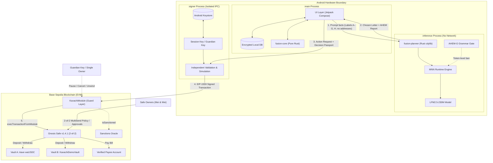
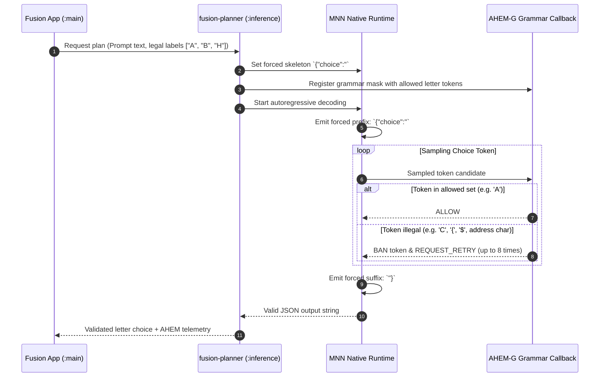
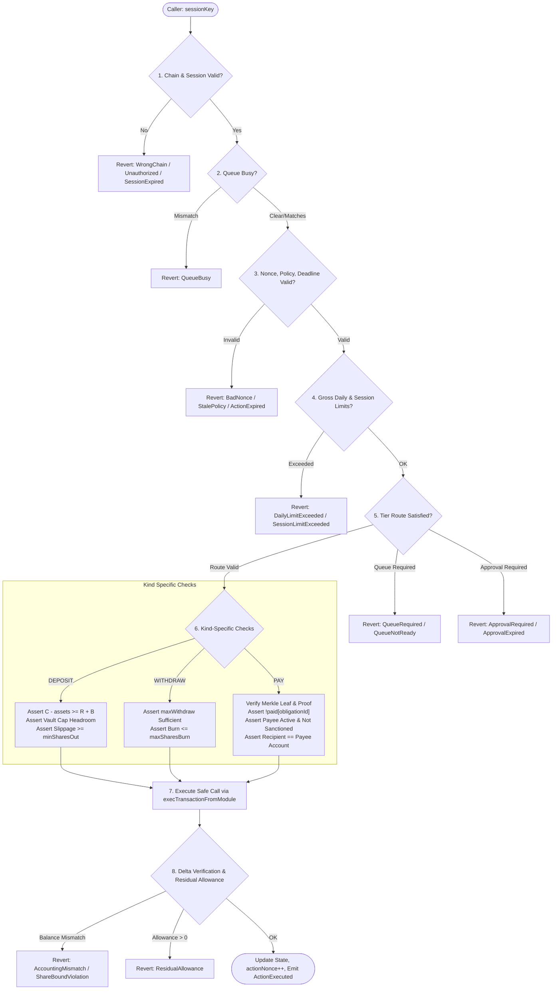

# Fusion Wallet — Technical Documentation

## Executive Summary & System Pitch

**Fusion Wallet** is an autonomous AI treasury management agent designed for small and medium-sized cross-border businesses operating with stablecoins (USDC). It solves a fundamental dilemma in autonomous financial agents: allowing an on-device Large Language Model (LLM) to perform active cash management (paying bills, monitoring reserves, and deploying surplus liquidity into yield vaults) without granting the model free-form authority to steal, misdirect, or lose funds.

In Fusion Wallet, the AI model operates strictly under a **bounded decision paradigm**. The inference engine is physically incapable of writing arbitrary addresses, calldata, or financial amounts. Instead, deterministic financial algorithms implemented in Rust enumerate a discrete set of fully validated candidate options, and a decode-time grammar gate (**AHEM-G**) inside the on-device inference runtime restricts token sampling such that the model can only choose between valid letter options (`A`–`G`, or `H` for HOLD). Every selected action is verified across five independent defense layers, culminating in the **Kavachi** on-chain guard layer—a Safe v1.4.1 module enforcing cryptographic commitments, reserve constraints, transaction velocity tiers, and two-person maker-checker controls.

---

## 1. Problem Context & Threat Model

Cross-border small enterprises frequently maintain operating balances in fiat-backed stablecoins without dedicated treasury staff. Operating in this environment presents critical operational and security hazards (sourced from `system architecture/fusion_wallet_architecture.md` §2.2 and §26):

1. **Business Email Compromise (BEC) and Invoice Redirection:** FBI IC3 recorded approximately 24,768 BEC complaints accounting for ~$3.05 billion in reported losses in 2025. Attackers compromise vendor email communications or generate lookalike invoices with altered payment details.
2. **Address Poisoning & Vanity Confusion:** Single crypto address poisoning theft events reached ~$50 million (December 2025) and ~$12.25 million (January 2026).
3. **Prompt Injection & Unconstrained AI Agent Authority:** Autonomous agents with access to generic tools (such as open transfer functions) are vulnerable to jailbreaks. In the May 2026 Grok/Bankr incident, an indirect Morse-code prompt injection caused an AI agent wallet to drain ~$150,000–$200,000.
4. **Reserve Depletion & Liquidity Traps:** Sweeping idle treasury funds into yield protocols risks locking capital needed for payroll or imminent vendor obligations.

### Threat Model & Assumptions
* **Untrusted Context:** Incoming invoices, vendor emails, and user prompts are treated as untrusted and potentially adversarial.
* **Potentially Compromised Inference Engine:** The LLM runtime is assumed to be susceptible to jailbreaking, prompt injection, and hallucination.
* **Non-Colluding Owners:** Owners Mei and Wei are honest but may be individually phished or tricked; security relies on a 2-of-2 Safe threshold for state-changing policy alterations.
* **Separation of Duties:** The agent session key has execution authority strictly inside on-chain policy parameters; it cannot alter policy, approve its own actions, or transfer assets to unregistered recipients.

---

## 2. System Architecture

Fusion Wallet splits execution into distinct security domains spanning the Android operating system and on-chain smart contracts.

### 2.1 Component Breakdown

| Component | Execution Context | Core Responsibilities | Explicit Security Invariants |
|---|---|---|---|
| **Fusion App UI (`:main`)** | Android Main Process | UI presentation (Jetpack Compose), local encrypted SQLite database (bills, payees), worker orchestration, on-chain state reconciliation, coarse cloud Accountant interface. | Holds no private keys; cannot sign transactions; cannot execute inference directly. |
| **Inference Engine (`:inference`)** | Isolated Android Process | Hosts `fusion-planner` (Rust cdylib) linking the AHEM-patched MNN runtime (`libMNN.so`, `libllm.so`) and model weights (LFM2.5-230M). Runs AHEM-G decode-time grammar gating and AHEM-L latent monitoring in shadow mode. | Holds no keys; has no network access permissions; never receives recipient addresses or raw amounts (prompts contain only lettered labels and rounded figures). |
| **Signer Process (`:signer`)** | Isolated Android Process | Manages key material (owner key, agent session key, guardian key) wrapped via Android Keystore. Enforces independent pre-signing checks, simulation via `eth_call`, and audit journaling. | Rejects generic calldata signing; only signs typed transactions validated against active policy. |
| **`fusion-core`** | Rust Engine (`.so`) | Pure deterministic math: integer economics, EIP-712/Keccak hashing, Merkle tree operations, candidate enumeration, snapshot processing, and passport generation. | Deterministic, panic-guarded, pure functions with no long-lived key storage. |
| **Safe Smart Account** | Base Sepolia (`0x029869910714D9e09b854a2688311AFd42fBb44E`) | Gnosis Safe v1.4.1 2-of-2 multi-signature account. Holds all treasury USDC and ERC-4626 vault share tokens. | Only executes external module calls initiated by the authorized `KavachiModule`. |
| **Kavachi Guard Layer (`KavachiModule`)** | Base Sepolia (`0xA560ec10259657E9bADd297E68286d2838Cd5a8f`) | Master guard module enabled on Safe. Validates cryptographic mandates, reserve invariants, amount tiers, payee cooling periods, and Merkle bill proofs. | Never executes delegatecall; value is strictly 0; call targets are strictly allowlisted. |
| **Vaults** | Base Sepolia ERC-4626 | Vault A: Aave V3 waUSDC wrapper; Vault B: `KavachiDemoVault` (`0x5e16B898eEc2DE5125E6B564F42A1690e80a5F34`). | Enforces share slippage bounds (50 bps) and exposure ceilings. |
| **Sanctions Oracle** | Base Sepolia (`0x429E2E2088f117c093aC3c50058eE5f3Fcecb46a`) | Test sanctions list interface (`isSanctioned`) evaluated at payee registration, queueing, and execution. | Fails closed on oracle revert (`SanctionsCheckFailed`). |

### 2.2 System Architecture Diagram

### 2.3 Trust Boundaries & Verification Sequence

1. **User / Invoice Context → Inference Engine:** Input texts are strictly bounded. Prompts presented to the LLM are generated solely by Rust code (`planner_io.rs`). Raw hexadecimal addresses, private keys, and unformatted amounts are never passed to the LLM.
2. **Inference Engine → App Runtime:** The LLM cannot emit free text. Output is constrained by AHEM-G to a JSON string `{"choice":"<LETTER>"}`. An independent output validator maps the emitted letter back to the candidate set digest.
3. **App Runtime → Signer Process:** The signer operates in an isolated process. It reconstructs the snapshot, re-verifies policy constraints, performs local `eth_call` delta simulation, and asserts that the `decisionHash` matches the signed canonical passport.
4. **Signer → Blockchain:** The `KavachiModule` contract enforces all rules on-chain independently of off-chain agents. Any discrepancy between off-chain calculation and on-chain state results in an immediate revert.

---

## 3. Core Algorithm: Candidate Enumeration & Integer Economics

The core algorithm is implemented in `src/fusion-core/src/candidates.rs` (specified in `fusion_wallet_architecture.md` §10.4). Given an on-chain snapshot $S$, current policy $P$, and committed unpaid obligations, the candidate generator outputs at most 7 actionable candidates plus a mandatory `HOLD` option ($H$).

### 3.1 Enumeration Priority

The algorithm executes in four deterministic stages:

1. **Due Obligations (PAY Candidates):**
   * Scans committed obligations where `now >= dueAt - payEarlyWindowSeconds`.
   * Asserts payee is `ACTIVE` (`now >= activeAt` and not cancelled).
   * Asserts payee is not sanctioned.
   * Asserts liquid treasury cash $C \ge \text{amount}$.
   * Sorts candidate bills primarily by earliest `dueAt`, and secondarily by `obligationIdHash`.
2. **Safety Liquidity Withdrawals (WITHDRAW Candidates):**
   * If liquid cash $C < R + B$ (where $R$ is committed obligations and $B$ is the operating buffer), a liquidity deficit exists.
   * Emits a `WITHDRAW` candidate for $\min(R + B - C, \text{maxWithdraw})$ targeting the lowest-yielding vault to replenish operating reserves.
3. **Surplus Liquidity Sweep (DEPOSIT Candidates):**
   * Evaluates sweepable cash: $\text{sweepable} = \max(C - R - B, 0)$.
   * If $\text{sweepable} > 0$, evaluates eligible vaults where current exposure is below the configured ceiling.
   * Generates a `DEPOSIT` candidate for $\min(\text{sweepable}, \text{exposure\_headroom})$ if and only if $\text{netBenefit} > \text{minNet}$.
4. **Rebalance [Phase-4 / Roadmap]:**
   * Compares yield spreads between Vault A and Vault B. Rebalancing is disabled at S0/S (`UnsupportedAction` error D16).
5. **HOLD (Mandatory Candidate $H$):**
   * Always present as the default action if no operations are profitable, legal, or necessary.

### 3.2 Label Assignment & Candidate IDs
After sorting, candidate actions receive letters `A`, `B`, … `G` in order; `HOLD` is assigned `H`.
The candidate identifier is computed cryptographically per §9:
$$\text{CandidateId} = \text{keccak256}(\text{abi.encode}(\text{TAG\_CANDIDATE}, \text{snapshotBlockHash}, \text{actionDigestWithoutDecision}))$$
where `actionDigestWithoutDecision` is the action digest calculated with `decisionHash = bytes32(0)`. This breaks circularity between candidate evaluation and decision generation.

### 3.3 Integer Economic Calculations
All financial operations use fixed-point integer mathematics (6 decimal places for USDC) to avoid IEEE-754 floating-point nondeterminism:
$$\text{grossYieldRaw} = \left\lfloor \frac{\text{assets} \times \text{rateBps} \times \text{horizonSec}}{10\,000 \times 31\,536\,000} \right\rfloor$$
$$\text{feeRaw} = \left\lceil \text{gasUnits} \times \text{maxFeePerGas} \times \text{ethUsdScenario} \right\rceil$$
$$\text{netBenefit} = \text{grossYieldRaw} - \text{feeRaw}$$
* `minNet`: 1.000000 USDC ($1 \times 10^6$ units).
* `horizonSec`: 30 days ($2\,592\,000$ seconds).
* Yield rates for Vault A are sampled dynamically from Aave V3 `currentLiquidityRate`. Vault B rates are scenario-driven and explicitly labeled as simulated in the decision passport.

### 3.4 Tier Routing Matrix
Every generated candidate is mapped to an execution route based on its asset value:

$$\text{Tier}(\text{assets}) = \begin{cases} 
\text{INSTANT} & \text{if } \text{assets} \le \text{microMaxRaw} \ (\le 10\text{ USDC}) \\ 
\text{DELAYED} & \text{if } \text{microMaxRaw} < \text{assets} \le \text{delayedMaxRaw} \ (\le 100\text{ USDC}) \\ 
\text{OWNER} & \text{if } \text{delayedMaxRaw} < \text{assets} \le \text{hardMaxRaw} \ (\le 2,500\text{ USDC}) \\ 
\text{REJECT} & \text{if } \text{assets} > \text{hardMaxRaw} 
\end{cases}$$

Under `AUTONOMOUS` policy:
* `INSTANT`: Executed immediately by the agent session key.
* `DELAYED`: Submitted to `queueAction`, enforced by a 180-second on-chain delay window during which any owner or guardian can cancel.
* `OWNER`: Requires a 2-of-2 Safe approval transaction before execution.

---

## 4. On-Device AI & Decode-Time Grammar Gating (AHEM-G)

In traditional agent systems, LLMs generate free-form text or function-call JSON which is parsed downstream. If an attacker injects instructions through invoice data, the model can emit malicious addresses or excessive amounts. Fusion Wallet neutralizes this attack surface at the tokenizer/sampling layer using **AHEM-G**.

### 4.1 AHEM-G Architectural Integration
AHEM-G embeds a Deterministic Finite Automaton (DFA) grammar validator into the core MNN sampling callback (`register_ahem_gate_callback`). 

### 4.2 Tokenizer Vocabulary Analysis
To prevent tokenizer multi-token splits, `fusion-planner` verifies the single-token representation of ASCII option characters in the LFM2.5 vocabulary directly following a double quote (`"`).
From `evidence/planner/host_results.json` (`validation.tokenizerLetters`):
* `A`: Token ID 542
* `B`: Token ID 543
* `C`: Token ID 544
* `D`: Token ID 545
* `E`: Token ID 546
* `F`: Token ID 547
* `G`: Token ID 548
* `H`: Token ID 549
* `leadingSpaceRequired`: `false`

### 4.3 Empirical Validation Evidence
Empirical performance is formally benchmarked in `evidence/planner/host_results.json` over a 200-sample adversarial suite (`AHEM-G-01` and `AHEM-G-02`):

| Metric / Check | AHEM-G Enforced (`AHEM-G-01`) | Plain MNN Baseline (`AHEM-G-02`) | Source File Reference |
|---|---|---|---|
| **Evaluated Adversarial Prompts** | 200 | 200 | `evidence/planner/host_results.json` |
| **Illegal / Malformed Outputs** | **0** | **48** (final aborts) | `host_results.json:AHEM-G-01/02` |
| **First-Attempt Invalid Outputs** | 0 | 49 | `host_results.json:AHEM-G-02` |
| **Sample-Level Vetoes Logged** | 46 | 0 (no gate present) | `host_results.json:AHEM-G-01` |
| **Forced Token Injections** | 1,000 | 0 | `host_results.json:AHEM-G-01` |
| **P50 Inference Latency** | **116.62 ms** | 139.96 ms | `host_results.json:AHEM-G-06` |
| **P95 Inference Latency** | **117.70 ms** | 145.03 ms | `host_results.json:AHEM-G-06` |
| **Cold Load Time** | 915.91 ms | 880.66 ms | `host_results.json:AHEM-G-01/06` |

*Note on Latency:* Plain baseline inference exhibits higher latency due to downstream JSON syntax failures triggering second-attempt retries. AHEM-G terminates parsing cleanly at 8 output tokens.

---

## 5. Cryptographic Hashing Contract & Decision Anchoring

All data structures in Fusion Wallet are bound by cryptographic domain separation tags defined in `spec/DECISIONS.md` and implemented in `src/contracts/src/HashV41.sol`.

### 5.1 Domain Separation Tags
Every digest is prepended with a compile-time Keccak-256 tag:
* `TAG_POLICY`: `keccak256("KAVACHI_POLICY_V4_1")` $\rightarrow$ `0xf260190c2a965028ff458ec4ffd9891199dfb657e0250e76bf3f68be71243998`
* `TAG_SESSION`: `keccak256("KAVACHI_SESSION_V4_1")` $\rightarrow$ `0xdd4af3d8f3e50bfb9b3c45617fa4ba78937866e38fef3d7c6b304b2ee1800972`
* `TAG_MANDATE`: `keccak256("KAVACHI_MANDATE_V4_1")` $\rightarrow$ `0xd720e98dfe2b80ec41201d4f7d9e0ddfbf35b36460f289c78a31c2fa5128aa6f`
* `TAG_ACTION`: `keccak256("KAVACHI_ACTION_V4_1")` $\rightarrow$ `0xb8178ae129065af1ead4d0d018f19dbc8667a4b7a334449fe4bee8f5a42d8c5e`
* `TAG_CANDIDATE`: `keccak256("KAVACHI_CANDIDATE_V4_1")` $\rightarrow$ `0xb8c00e565ec7fb3feb1955188facef397ec149cc393fc749df462a6f0c4ae9bb`
* `EMPTY_OBLIGATIONS_ROOT`: `keccak256("KAVACHI_EMPTY_OBLIGATIONS_V4")` $\rightarrow$ `0x23741c6f1f8567b5bb9370afa7a28d473bc35c8ccc38118af5346e6d25f8fee0`

### 5.2 Deterministic Vault Sorting in PolicyHash
To ensure cross-platform hash parity regardless of declaration order:
$$\text{vaultLimitsHash} = \text{keccak256}(\text{abi.encode}((\text{address}, \text{uint256})[] \ \text{sortedVaultLimits}))$$
The array of vault limits is sorted ascending by address in memory before hashing (`uint160(vaultAddress)`).

### 5.3 Obligation Merkle Tree Structure
Committed invoices are committed on-chain as a Merkle root. To prevent second-preimage attacks:
$$\text{InnerHash} = \text{keccak256}(\text{abi.encode}(\text{obligationIdHash}, \text{payeeIdHash}, \text{amountRaw}, \text{dueAt}))$$
$$\text{ObligationLeaf} = \text{keccak256}(\text{bytes.concat}(\text{InnerHash}))$$
Sibling nodes are sorted lexicographically:
$$\text{hashPair}(a, b) = \begin{cases} \text{keccak256}(\text{bytes.concat}(a, b)) & \text{if } a < b \\ \text{keccak256}(\text{bytes.concat}(b, a)) & \text{otherwise} \end{cases}$$

### 5.4 Decision Passport & On-Chain Anchoring
For every executed agent action, a full audit record is serialized as a canonical JSON passport per RFC 8785 JSON Canonicalization Scheme (JCS).
$$\text{decisionHash} = \text{keccak256}(\text{UTF8}(\text{JCS}(\text{Passport})))$$
The `decisionHash` is embedded directly into the on-chain `Action` struct and emitted by the `ActionExecuted` and `ActionQueued` events. External auditors can verify any on-chain transaction by recomputing the Keccak-256 digest of the published passport and comparing it against the transaction log.

---

## 6. On-Chain Security Architecture (Kavachi Guard Layer)

The `KavachiModule` contract (`src/contracts/src/KavachiModule.sol`) is the sole authorized module attached to the 2-of-2 Safe.

### 6.1 Multi-Layer Defense in Depth
Fusion Wallet enforces security across five distinct boundaries:
1. **Layer 1: AHEM-G Token Grammar Gate:** Physical restriction on the sampler preventing output outside `A`–`H`.
2. **Layer 2: Strict Output Validator:** Re-validates JSON syntax and asserts candidate set digest correspondence.
3. **Layer 3: Rust Preview Simulation:** Pure off-chain re-execution of all on-chain rules prior to transaction formation.
4. **Layer 4: Signer Process Isolation:** Independent re-verification of chain state and local `eth_call` delta checks.
5. **Layer 5: Kavachi Smart Contract Module:** Non-reentrant EVM execution asserting state constraints, limits, and Merkle proofs.

### 6.2 On-Chain Reserve Accounting
The module maintains strict liquidity conservation to ensure bill obligations cannot be compromised by yield operations:
* $C = \text{USDC}.\text{balanceOf}(\text{safe})$ (Liquid cash)
* $R = \text{reservedRaw}$ (Committed unpaid obligations balance)
* $B = \text{operatingBufferRaw}$ (Configured cash safety buffer)

$$\text{Liquidity Invariant (I1): } \ C - \text{assets} \ge R + B$$

If $C < R$, the wallet enters an **underfunded state**. During underfunding, `DEPOSIT` operations revert immediately with `Underfunded`. Only `WITHDRAW` and `PAY_OBLIGATION` actions are permitted.

### 6.3 Normative Guard Execution Flow (§7.7)
Every call to `KavachiModule.execute` executes the following normative sequence prior to any state modification or external call:

### 6.4 One-Tap Emergency Unwind
If market conditions destabilize or anomalous behavior is detected, any single owner or the designated guardian can invoke `emergencyUnwind(reasonCode)`. The module:
1. Immediately pauses all agent execution and increments `policyEpoch`.
2. Cancels any pending queued action (consuming the nonce).
3. Revokes the active agent session key.
4. Iterates through all configured vaults, executing `vault.redeem(allShares, safe, safe)`. Each leg is isolated in a try/catch block so a reverting vault cannot block liquidation of the other.
5. All redeemed funds are returned directly to the Safe treasury.

---

## 7. Standards Alignment & Interoperability

Fusion Wallet aligns with emerging smart account and autonomous agent standards (`system architecture/fusion_wallet_architecture.md` §2.7):

| Standard | Ecosystem Role | Fusion Wallet Architecture Implementation | Alignment Claim |
|---|---|---|---|
| **Safe v1.4.1** | Account Abstraction Core | Uses official, unmodified Safe singleton and proxy contracts. `KavachiModule` is enabled as the primary guard module. | "Built on Safe" |
| **ERC-4626** | Tokenized Vault Standard | Interfaces with Aave V3 waUSDC wrapper and custom demo vaults using standard preview and redemption calls. | "Uses ERC-4626" |
| **ERC-7715** | Scoped Wallet Permissions | Translates permission-granting paradigms into deterministic on-chain policy epochs, session keys, and spending caps. | "Same model as ERC-7715; not an implementation of it" |
| **ERC-8004** | Trustless Agent Identity | Anchors off-chain decision passports via cryptographic `decisionHash` emitted in transaction events. | "Compatible validation direction" |
| **RFC 8785** | JSON Canonicalization (JCS) | Normalizes audit passports to ensure consistent cross-platform Keccak-256 digests. | "Uses RFC 8785 (JCS)" |
| **EIP-712** | Structured Data Signing | Safe multi-signature approvals utilize standard EIP-712 typed signatures (`SafeTx`). | "Uses EIP-712" |
| **EIP-1967** | Standard Proxy Storage Slots | Monitors implementation slots of third-party vault proxies to detect unauthorized logic upgrades. | "Uses EIP-1967" |
